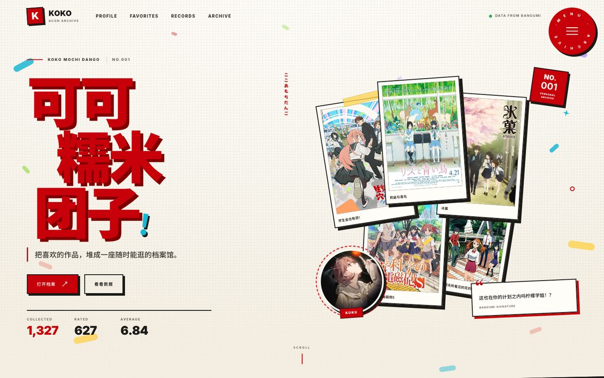

# KOKO / ACGN Archive

个人 ACGN 档案馆 — 以动画官网的视觉语法（纸白点阵、朱红标题、印章菜单、贴纸卡片、荧光纸屑）重做的 Bangumi 兴趣展示页。没有视频，没有后端，也没有构建步骤。

数据来自 [Bangumi 番组计划](https://bgm.tv) 的公开 API，页面读取的是仓库里的 `data.json` 快照；换账号、换本命、换文案都不需要改 JS。



## 文档

- [CHANGELOG.md](CHANGELOG.md) — 这一晚改了什么、已知边界
- [TODO.md](TODO.md) — 明早可以一起补的个人内容与取舍

## 本地预览

```bash
cd bgm-showcase
python3 -m http.server 8000
# 打开 http://localhost:8000
```

不要直接双击 `index.html`：浏览器会拦截 `fetch('data.json')`。

## 页面里有什么

| 区块 | 内容 | 数据来源 |
|---|---|---|
| HERO | 站名、总收藏 / 评分 / 均分、封面拼贴、本命头像 | `profile` + `collections` + `featured` |
| PROFILE | 头像、签名、简介、口味标签、四个“此刻”卡片 | `profile`、`collections`、`characters` |
| FEATURED | 最近沉迷：《学生会也有洞！》专属大卡 | `featured` + 对应收藏 |
| FAVORITES | 5 位最爱角色：生日、身高、血型 | `characters` |
| WATCHING | 最近在看的进度、话数、更新时间 | `collections?type=3` |
| WISHLIST | 472 部想看里的最近 8 部，横向书架 + 随机抽一部 | `collections?type=1` |
| RECORDS | 总览数字、评分分布、收藏状态、年份分布、口味关键词、制作公司、口味散点图 + 评分分歧 | 全量收藏计算 |
| TOP RATED | 动画 / 书籍 / 游戏各自的前 5 名 | 我的评分排序 |
| ARCHIVE | 48 张精选封面 + 全量 1,327 部实时搜索，可分批“显示更多”；点封面打开作品详情 | 评分最高 + 最近更新 |
| WORDS | 从短评里抽的三句话 | `collections.comment` |

## 更新数据

```bash
python3 scripts/fetch_bgm.py
```

脚本会重新抓取公开收藏、5 位角色和 featured 条目，覆盖 `data.json`。全程只读，不需要 token；请求之间有间隔，遇到 429/5xx 会退避重试。

- 换 Bangumi 用户名：`BGM_USERNAME=yourname python3 scripts/fetch_bgm.py`
- 换最爱角色：同时改 `scripts/fetch_bgm.py` 里的 `CHARACTER_IDS` 和 `content.js` 里的 `favoriteOrder`
- 换 featured 作品：改 `scripts/fetch_bgm.py` 里的 `FEATURED_SUBJECT`，再改 `index.html` 里 `#feature-link` 的默认链接即可

`data.json` 是提交进仓库的快照，所以页面不依赖实时 API。页脚的 `DATA SNAPSHOT` 就是最后一次抓取时间；**收藏更新后不会自动出现在页面里**，需要重新跑一次脚本（或部署后等每周一的 Actions）。仓库里带了一条 GitHub Actions 定时任务（`.github/workflows/refresh-data.yml`），每周一自动跑脚本，数据有变化才提交；不需要的话删掉这个文件即可。

## 改“我”的部分

所有个人文案集中在 `content.js`，不需要翻 HTML：

```js
window.SITE_CONTENT = {
  tagline: '首屏一句话',
  intro: '关于我的简介',
  quote: '首屏小纸条 / 签名',
  favoriteOrder: [3575, 24760, 19041, 14823, 53770],
  socials: [
    { label: 'BANGUMI', href: 'https://bgm.tv/user/m1n' },
    { label: 'X', href: 'https://x.com/m1n645372' },
    { label: 'GITHUB', href: 'https://github.com/nizihan29' },
  ],
  quotes: [
    { text: '我很好奇。', from: '《冰菓》千反田爱瑠' },
  ],
};
```

文件底部留了 TODO：最近循环的歌、喜欢的监督/公司/声优、圣地巡礼、想换的台词、其他社交主页。想加板块时，先补数据，再加一个 `<section>` 和对应的 render 函数即可。

## 设计说明

- **配色**：纸白 `#fbf8f1`、朱红 `#c7000a / #7d0000`、墨黑 `#1c1a17`，青色/粉色/黄色只做点缀。
- **字体**：本地 subset 的 Inter（英文/数字）、Mochiy Pop One（静态日文小标签）、Noto Sans SC 900（首屏名字），总共约 44 KB；动态中文/日文回退系统字体。主页面不再依赖 Google Fonts（404 页仍保留 CDN 回退），字体授权文件在 `assets/fonts/`。
- **菜单**：右上角嵌在屏幕边缘的印章按钮，圆外弧形 MENU / CLOSE，圆内三横变 X；打开后全屏红底白点，左侧是站名（含罗马音）和 BANGUMI / X / GitHub，右侧是「编号 + 英文大标题 + 日文小注」的目录，支持 Esc、焦点循环和滚动锁（用 `position: fixed` 保存/恢复位置，iOS 上也不会滚穿背景）。
- **卡片**：白底、粗描边、硬阴影、轻微旋转和胶带；数据区保持白卡，先保证可读，再谈风格。
- **动效**：滚动 reveal、跑马灯、柱状图生长、封面悬停；全部尊重 `prefers-reduced-motion`。
- **响应式**：1440 / 1024 / 768 / 390 / 320 五档验证，Chromium / WebKit / Firefox 都过了一遍；平板的 5 张角色卡会重排成居中的 3+2。
- **搜索**：收藏墙支持标题（中/日）、年份、标签的即时过滤；搜索时自动回到 ALL，避免被当前类型筛选挡住。RECORDS 里的年份柱和口味标签也可直接点击，带着条件跳到收藏墙；搜索结果超过 48 条时可以继续展开。
- **详情弹窗**：点收藏墙/搜索结果里的封面，会在页内打开作品详情（我的评分、状态、进度、标签、短评），`Ctrl/⌘` 点击仍直接去 Bangumi；WISHLIST 的“随机抽一部”也会用同一个弹窗。
- **打印 / PDF**：页脚有“打印 / PDF”，打印样式会隐藏菜单、搜索、收藏墙等交互区，输出 5 页 A4 的档案摘要。详情支持 `#work-<id>` 深链和“复制链接”，打开/关闭会同步浏览器历史；收藏墙搜索会把关键词写进 `?q=`，可以直接分享搜索结果。
- **制作公司**：按收藏条目的公司标签统计 Top 8，标签可能漏计，所以面板里标了“按标签统计”，当参考而不是官方数据。

参考的是动画官网的**语法**（版式、字重、红白关系、印章菜单、纸屑），没有使用官网的 logo、插画或视频素材。

## 质量检查

```bash
python3 scripts/check_site.py
```

会检查 `data.json` 的字段/数量/重复项、HTML 的重复 id、锚点目标、本地资源、图片 alt、viewport 等；CI 里还有一条 `.github/workflows/check.yml` 跑同样的检查和语法检查。

## 部署到 GitHub Pages

当前线上：https://nizihan29.github.io/bgm-showcase/  
仓库：https://github.com/nizihan29/bgm-showcase

```bash
git add .
git commit -m "feat: anime-official-site style ACGN archive"
git branch -M main
git remote add origin https://github.com/<你的用户名>/bgm-showcase.git
git push -u origin main
```

仓库 **Settings → Pages → Source** 选 `main` / `(root)`，几十秒后访问：

```text
https://<你的用户名>.github.io/bgm-showcase/
```

`data.json`、`content.js`、`scripts/` 都会一起发布；没有构建步骤。仓库里带了 `.nojekyll`、`robots.txt` 和一个同风格的 `404.html`，GitHub Pages 找不到路径时会回到这张“迷路的档案”。

## 技术说明

- 纯静态：`index.html` + `style.css` + `app.js` + `content.js` + `data.json`
- 本地字体 subset 约 44 KB，替代原先 Google Fonts 的 50+ 个请求 / 约 1.9 MB
- 带 `site.webmanifest`、192/512 主屏图标和 `apple-touch-icon`；可以“添加到主屏幕”，但没有做离线缓存
- 零依赖、零构建；`scripts/fetch_bgm.py` 只用 Python 标准库
- 图片直接引用 `lain.bgm.tv` 的公开封面，`loading="lazy"`；加载失败会自动替换成占位图
- `data.json` 约 890 KB（未压缩）；页面首屏只加载 hero / profile 所需图片
- 兼容现代浏览器；不支持 `IntersectionObserver` 时会直接显示全部内容

## 版权

本页是个人兴趣展示，非官方站点。作品封面、角色画像的版权归各自原作者及版权方所有；数据与图片来自 Bangumi。页面代码可自由修改自用。
